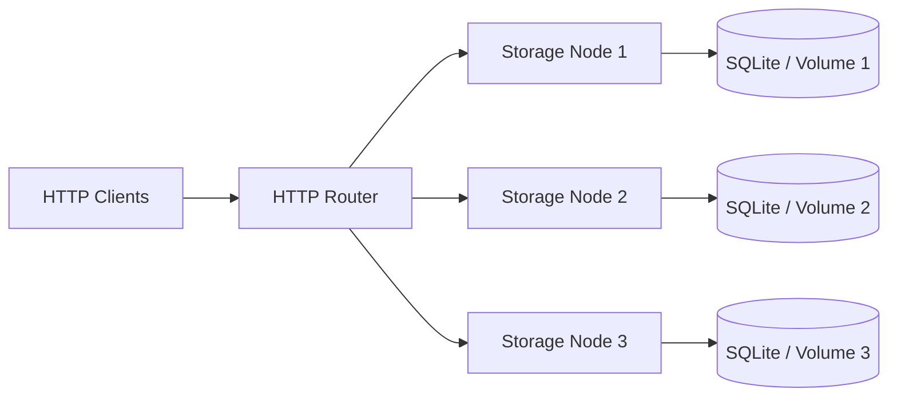
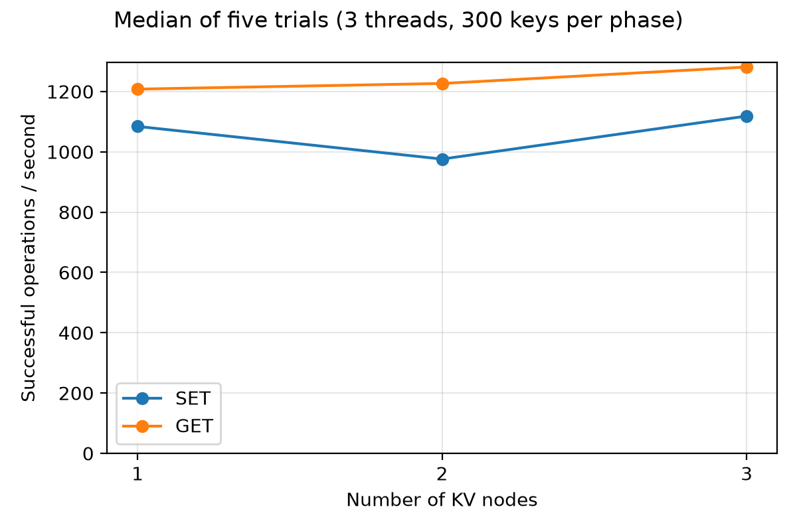
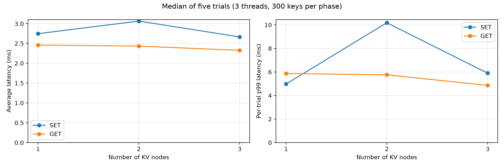

# Distributed Persistent Key-Value Store

**Python · SQLite · Consistent Hashing · Docker**

A containerized HTTP storage service with durable writes, deterministic key
partitioning, and asynchronous request handling. The system supports standalone
operation and a sharded cluster of up to three storage nodes behind a routing
service. Its design combines SQLite persistence with bounded caching and
connection reuse, supported by correctness tests and recorded performance studies.

**Author:** [Samarth Kumar Samal](https://github.com/samarthkumarsamal)  
**License:** [MIT](LICENSE)

## Project Overview

The project addresses three core concerns in cloud storage systems:

- **Persistence:** committed values survive server and container recreation.
- **Partitioning:** consistent hashing maps each key to a stable storage owner.
- **Concurrency and efficiency:** asynchronous HTTP, persistent connections,
  encoded-response caching, and grouped commits reduce request overhead.

The default deployment runs one router process and three independent SQLite
storage nodes. Membership is explicitly configured; changes use a planned
maintenance procedure.

## System Architecture



The router hashes each key with SHA-256 and locates its owner on a ring with
150 virtual nodes per storage node. Requests are forwarded over bounded pools
of persistent HTTP/1.1 connections. Each key has one authoritative owner, and
each node maintains its own database and named Docker volume.

### Storage and Concurrency Model

SQLite uses write-ahead logging and `synchronous=FULL`. A dedicated writer
serializes mutations and groups up to 64 already-queued operations into a
transaction without adding a batching timer. Successful changed writes are
acknowledged after commit, and cached values are published after commit.

A bounded LRU cache stores immutable, encoded GET responses. The default
payload/key budget is 64 MiB, with a maximum of 65,536 entries; Python object
overhead is additional. Strict coherence checks SQLite `data_version` to
detect commits made by other connections.

An identical cached value that is already committed can satisfy a repeated
write without another database write. Consequently, fresh inserts, changed
values, and identical repeated writes are measured separately.

## Technology Stack

| Component | Technology |
| --- | --- |
| Application | Python |
| Asynchronous HTTP | Uvicorn and httptools |
| Event loop | uvloop on supported Linux deployments; asyncio on Windows |
| Persistent storage | SQLite with WAL and FULL synchronization |
| Partitioning | SHA-256 consistent hashing with virtual nodes |
| Deployment | Docker and Docker Compose |
| Analysis | CSV measurements and Matplotlib figures |

## Requirements

- Docker Engine or Docker Desktop with Linux containers and Compose v2+.
- Python 3.11+ for the asynchronous engine; the tested Windows version was 3.11.6.
- Containers use `python:3.12-alpine` and install pinned dependencies from
  `requirements-fast.txt`.
- The standard-library threaded engine supports Python 3.10+.
- Matplotlib is required only to regenerate performance graphs.

## Deployment

Choose one deployment mode at a time; each uses host port 8080 by default.

### Three-Node Cluster

```bash
git clone https://github.com/samarthkumarsamal/kv-store-cc.git
cd kv-store-cc
```

Keep host ports 8080-8083 available. If the separate benchmark deployment is
active, stop it before starting the main cluster:

```bash
docker compose -f compose.bench.yaml --profile two --profile three stop
```

Build and start the main cluster:

```bash
docker compose build node1 router
docker compose -f compose.yaml up -d --wait --wait-timeout 120
docker compose -f compose.yaml ps
```

| Service | Host Endpoint | Purpose |
| --- | --- | --- |
| Router | http://127.0.0.1:8080 | Client API |
| node1 | http://127.0.0.1:8081 | Direct inspection and placement verification |
| node2 | http://127.0.0.1:8082 | Direct inspection and placement verification |
| node3 | http://127.0.0.1:8083 | Direct inspection and placement verification |

Use `compose.yaml` alone for the default one-worker router configuration.

### Standalone Python Service

Activate a virtual environment, install the runtime dependencies, and start
the server on an available port:

```bash
python -m pip install -r requirements-fast.txt
python server.py --engine async --database data/kv.db
```

The default address is `http://127.0.0.1:8080`. The alternative
`--engine threaded` selects the standard-library implementation.

### Standalone Container

```bash
docker build -t kv-store:1.0 .
docker run -d --name kv-store --init -p 127.0.0.1:8080:8080 -v kv-data:/data kv-store:1.0
```

The container runs as an unprivileged user. Its database is `/data/kv.db`,
stored in the `kv-data` named volume. The image includes an HTTP health check.
Application modules are copied into the image, and pinned dependencies are
installed during the build. `EXPOSE 8080` declares the service port;
`ENTRYPOINT ["python", "server.py"]` starts the server, with default arguments
binding to `0.0.0.0:8080` inside the container.

## HTTP API

| Method | Resource | Request | Successful Response |
| --- | --- | --- | --- |
| POST or PUT | `/{key}` | JSON object containing `value` | 200 with confirmation |
| GET | `/{key}` | No body | 200 with `{"value": ...}` |
| DELETE | `/{key}` | No body | 200 with confirmation |

POST and PUT create or replace a value. Values may be JSON strings, finite
numbers, arrays, objects, booleans, or null. Write requests require
`Content-Type: application/json` and valid Content-Length framing.

- Maximum request body: **1 MiB**.
- Maximum key length: **1,024 UTF-8 bytes**.
- Keys must be non-empty; reserved URL characters must be percent-encoded.
- The root path `/` has no key and returns 400.

### Example Requests

These examples use Windows Command Prompt quoting:

```bat
curl -i -X PUT http://127.0.0.1:8080/project_demo -H "Content-Type: application/json" --data "{\"value\":\"Cloud Computing\"}"
curl -i http://127.0.0.1:8080/project_demo
curl -i -X DELETE http://127.0.0.1:8080/project_demo
```

The GET response contains:

```json
{"value": "Cloud Computing"}
```

| Status | Meaning |
| --- | --- |
| 400 | Invalid key, JSON, or request framing |
| 404 | Key not found |
| 405 | Unsupported method in the asynchronous engine |
| 500 | Storage operation failed |
| 502 | Selected upstream node could not complete the request |
| 503 | Selected node's connection pool is busy |

## Runtime Configuration

| Option | Component | Default | Purpose |
| --- | --- | --- | --- |
| `--engine` | Server and router | `auto` | Select `async`, `threaded`, or automatic detection |
| `--storage` | Server | `sqlite` | Persistent SQLite or explicitly volatile memory storage |
| `--cache-mib` | Server | `64` | Encoded-response cache payload/key budget |
| `--cache-coherence` | Server | `strict` | Detect external database commits |
| `--batch-size` | Server | `64` | Maximum queued mutations grouped per transaction |
| `--access-log` | Server and router | `on` | Timestamped operation logging |
| `--virtual-nodes` | Router | `150` | Ring positions per storage node |
| `--workers` | Router | `1` | Asynchronous router process count |

The optional two-worker experiment uses:

```bash
docker compose -f compose.yaml -f compose.workers.yaml up -d --wait
```

One worker remains the selected default based on the recorded local tests.
Storage nodes remain single-process.

## Validation

Run storage and hash-ring checks independently:

```bash
python storage.py
python test_consistent_hash.py
```

With the three-node cluster running:

```bash
python test_api.py
python kv_bench.py
python check_distribution.py
```

The API suite contains seven tests covering CRUD, missing keys, JSON values,
invalid input, independent concurrent requests, same-key writes, and concurrent
writes/deletes. Nine hash-ring tests cover determinism, membership changes,
invalid configuration, and Unicode keys.

The placement checker verifies the default 300 benchmark keys and their
values on the expected owners. The recorded distribution was 78, 115, and
107 keys, with 300/300 correct values and zero placement problems. It expects
fixed three-node membership without stale copies from previous memberships.

## Performance Evaluation

Measurements were collected locally using Docker Desktop/WSL2. Client location,
concurrency, key count, runtime version, and write history are identified below.
SQLite FULL durability and operation logging remained enabled.

### Node-Count Study: Intermediate Threaded Runtime

Each configuration used three client threads and 300 keys per phase, with one
warm-up and five measured trials. Values below are medians across those trials.
SET reused the warm-up key/value dataset; these measurements describe repeated
workloads rather than fresh-insert capacity.

| Storage Nodes | SET ops/s | GET ops/s | SET Average ms | GET Average ms |
| ---: | ---: | ---: | ---: | ---: |
| 1 | 1,084.3 | 1,208.0 | 2.75 | 2.46 |
| 2 | 976.0 | 1,226.7 | 3.06 | 2.43 |
| 3 | 1,118.5 | 1,281.3 | 2.66 | 2.33 |





These results show modest, non-monotonic scaling. A matched one-/two-/three-node
study for the current asynchronous engine remains open. The committed CSVs
and figures retain their intermediate-runtime provenance.

### Asynchronous Runtime: Write Workloads

The following are separate single-run phases with three storage nodes, three
client threads, and 3,000 keys. The client ran inside the router container.

| Workload | Throughput ops/s | Average ms | p99 ms |
| --- | ---: | ---: | ---: |
| Fresh inserts | 1,035.4 | 2.89 | 9.10 |
| Changed values | 1,459.5 | 2.05 | 4.61 |
| Identical repeated values | 3,174.8 | 0.94 | 1.97 |

All write phases and subsequent read verification phases completed without
errors or mismatches. The workload tool removed its temporary keys afterward.
Identical repeated writes may avoid redundant database writes, so they are
reported separately from new or changed data.

### Router Process Comparison

A separate client container performed 20 GET runs per configuration, using
16 client threads and 3,000 keys per run. Each configuration verified 60,000
reads with zero errors or mismatches.

| Router Processes | Median ops/s | Median Average ms | Median Per-Run p99 ms |
| ---: | ---: | ---: | ---: |
| 1 | 4,645.0 | 3.43 | 10.97 |
| 2 | 4,525.8 | 3.52 | 12.41 |

Two processes did not demonstrate an improvement in these sessions. The runs
were collected at different times; the small throughput difference does not
establish statistical significance. Each p99 entry is a median of per-run
percentiles rather than a pooled percentile.

### Reproducing Workloads

```bash
python kv_bench.py --threads 3 --keys 3000
python bench_write_workloads.py --threads 3 --keys 3000
```

The first tool retains `key_0` onward. The second uses a unique UUID namespace
to measure fresh, changed, and repeated values, verifies responses, and cleans
up its own keys. The bundled load generator uses `http.client`; results from
different client libraries or network paths should be identified separately.

The commands above measure the host-to-container path. To use the internal
router-container path recorded in the write-workload table:

```bash
docker compose cp kv_bench.py router:/tmp/kv_bench.py
docker compose cp bench_write_workloads.py router:/tmp/bench_write_workloads.py
docker compose exec -T router python /tmp/bench_write_workloads.py --threads 3 --keys 3000
```

Copy the scripts again after recreating the router container.

For node-count experiments, the `kv-benchmark` project provides these configurations:

| Nodes | Start Command | Measurement Command |
| ---: | --- | --- |
| 1 | `docker compose -f compose.bench.yaml up -d --wait` | `python run_trials.py --nodes 1` |
| 2 | `docker compose -f compose.bench.yaml -f compose.two.yaml --profile two up -d --wait` | `python run_trials.py --nodes 2` |
| 3 | `docker compose -f compose.bench.yaml -f compose.three.yaml --profile three up -d --wait` | `python run_trials.py --nodes 3` |

Stop the main cluster and the previous benchmark configuration before switching.
The runner checks membership and refuses to overwrite existing result CSVs.
Archive earlier result batches before collecting new ones. Benchmark membership
switches write all test keys before reading and are separate from live-data migration.

Generate tables and figures from a complete measurement batch with:

```bash
python -m pip install matplotlib
python plot_results.py
```

## Operations and Persistence

```bash
docker compose -f compose.yaml ps
docker compose -f compose.yaml logs --tail 50
```

To verify persistence, populate the benchmark keys, stop the cluster, recreate
it with the same project and named volumes, then run GET without another SET:

```bash
python kv_bench.py set --keys 3000
docker compose -f compose.yaml stop
docker compose -f compose.yaml up -d --force-recreate --wait --wait-timeout 120
python kv_bench.py get --keys 3000
```

A recorded GET-only check verified all 3,000 values after recreation, with
zero errors or mismatches. Named volumes retain data across containers;
`docker compose down -v` removes those volumes.

Operation logs record timestamps, methods, paths, selected nodes at the router,
and response status codes. Stored values are excluded. Bounded queues apply
backpressure and flush during normal shutdown; abrupt termination can lose
queued log records. Health probes check HTTP responsiveness rather than
complete database integrity.

## Membership Management

Changing the hash ring changes ownership without relocating stored records.
The export/import utilities support a planned maintenance workflow for the
separate `kv-benchmark` project:

1. Pause its router and all other writers.
2. Export a fresh snapshot from the current authoritative owners.
3. Start destination nodes and import the snapshot into their new partitions.
4. Verify copied values and configure the target membership.
5. Resume the router and perform GET-only verification before new writes.

Migration requires downtime and commits independently on each node. The current
importer upserts records and retains existing destination rows. Reused volumes
can therefore retain stale or previously deleted values; complete destination
reconciliation remains an open improvement. Old copies are not replicas.

## Code Organization

| Files | Responsibility |
| --- | --- |
| `server.py`, `storage.py` | Storage API, persistence, caching and commit coordination |
| `router.py`, `consistent_hash.py` | Request routing and deterministic ownership |
| `fast_runtime.py`, `fast_http.py` | Asynchronous runtime and upstream transport |
| `access_logging.py`, `runtime_logging.py` | Background operation logging |
| `test_api.py`, `test_consistent_hash.py`, `check_distribution.py` | Correctness and placement verification |
| `kv_bench.py`, `bench_write_workloads.py`, `run_trials.py`, `plot_results.py` | Workload execution and performance analysis |
| `export_cluster.py`, `migrate_cluster.py` | Planned membership migration |
| Dockerfiles and Compose configurations | Packaging, networking and persistent volumes |
| `reports/` | Technical reports, raw measurements, summaries and figures |

## Technical Reports

- [Storage architecture, concurrency and error handling](reports/assignment1.md)
- [Container deployment and persistence validation](reports/assignment2.md)
- [Consistent hashing, migration and performance evaluation](reports/assignment3.md)
- [Node-count benchmark summary](reports/benchmark_comparison.md)

## Current Limits and Development Priorities

The system uses explicitly configured membership and one authoritative owner per
key. Replication, automatic storage-node failover, online migration, authentication,
and TLS are not implemented. The router is a single point of failure.

Development priorities are complete-state migration with recoverable backups,
replication and recovery, security controls, and a repeated node-count study of
the current asynchronous runtime under matched workload conditions.

## License

Distributed under the [MIT License](LICENSE).
