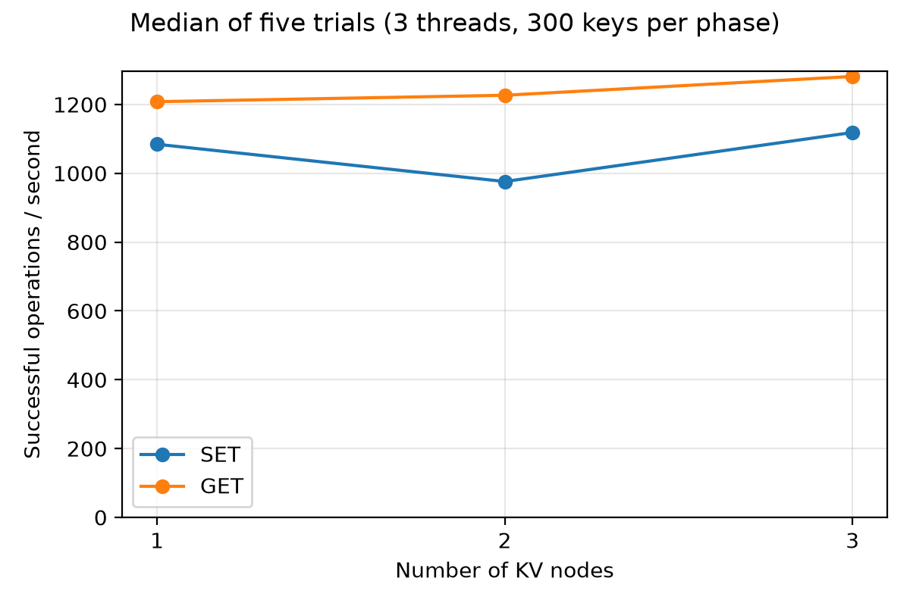
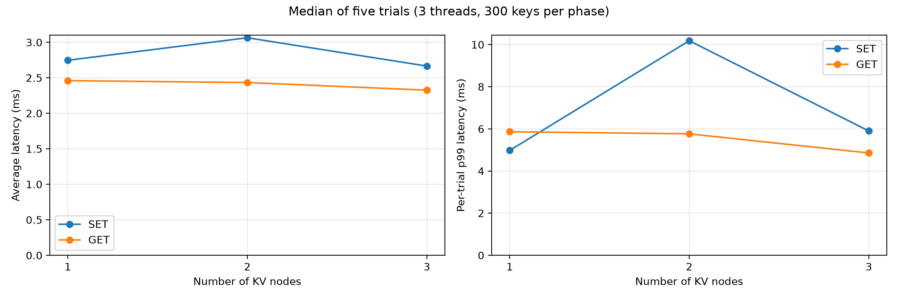

# Assignment 3: Distributed Python Key-Value Store

**Student:** Samarth Kumar Samal  
**Course:** CSCI 5144: Cloud Computing

## Objective and architecture

Distribute the persistent KV service across one to three storage nodes using
consistent hashing, containerize the components, and measure throughput and
latency as the system changes.

Clients send GET, POST/PUT, and DELETE requests to the router on port 8080.
The router chooses the owning node and forwards the request using a bounded
pool of persistent upstream connections. Each node has its own Python server,
SQLite database, and Docker named volume. The async engine uses Uvicorn,
httptools and, on Linux, uvloop. The standard-library threaded engine remains
available.

The ring uses SHA-256 and 150 virtual nodes per stable node name. A key belongs
to the first clockwise ring position at or after its hash, wrapping at the end.
Rebuilding the same membership produces the same ownership regardless of node
input order. Virtual nodes improve balance without guaranteeing exact equality.

SQLite uses WAL and `synchronous=FULL`. Each node's writer groups queued
mutations without an artificial batching delay and acknowledges committed
writes. Bounded encoded-response caching reduces GET conversion work, with
strict SQLite `data_version` coherence. Identical committed values can satisfy
repeated writes without another disk write. Operation logging stays enabled.

Docker Compose supplies networking, service discovery, health checks and
persistent volumes. The main project, `kv-cluster`, contains three nodes and
one router. The independent `kv-benchmark` project supports controlled
one-/two-/three-node experiments. Both publish port 8080, so only one should
publish that port at a time.

## Routing and API correctness

Nine consistent-hash tests passed, covering deterministic routing, node order,
membership changes, invalid inputs and Unicode. For 10,000 demonstration keys:

| Membership | node1 | node2 | node3 | Ownership changed on addition |
| --- | ---: | ---: | ---: | ---: |
| 1 node | 10,000 | - | - | - |
| 2 nodes | 5,110 | 4,890 | - | 48.90% |
| 3 nodes | 3,202 | 3,457 | 3,341 | 33.41% |

Adding node3 moved ownership only to node3. This tests routing, not physical
data movement.

The seven API integration tests passed against the updated Docker cluster,
including concurrent writes to one key and concurrent PUT/DELETE operations.
The earlier 300-key placement check verified 78 keys on node1, 115 on node2,
and 107 on node3, with every value correct and no unexpected copies.

## Node-count experiment before the final async runtime

The latest local `benchmark_1_nodes.csv`, `benchmark_2_nodes.csv`, and
`benchmark_3_nodes.csv` describe the intermediate threaded optimization stage,
before the final async runtime was added. Windows clients used Docker
Desktop/WSL2, three threads and 300 keys per phase. Each configuration had
one warm-up and five measured trials; every trial wrote the keys before
reading them. All measured requests succeeded. The three
`benchmark_*_nodes_before_optimization.csv` files preserve the earlier baseline.

The local `benchmark_comparison.md` reports these five-trial medians:

| Nodes | SET ops/s | GET ops/s | SET average (ms) | GET average (ms) | SET p99 (ms) | GET p99 (ms) |
| ---: | ---: | ---: | ---: | ---: | ---: | ---: |
| 1 | 1,084.3 | 1,208.0 | 2.75 | 2.46 | 4.98 | 5.86 |
| 2 | 976.0 | 1,226.7 | 3.06 | 2.43 | 10.18 | 5.76 |
| 3 | 1,118.5 | 1,281.3 | 2.66 | 2.33 | 5.90 | 4.86 |

Each p99 entry is the median of five per-trial p99s, not a pooled percentile.
From one to three nodes, SET throughput rose about 3.2% and GET throughput
about 6.1%. SET throughput dipped at two nodes, whose SET p99 also increased.
These short observations show modest, non-monotonic scaling rather than
linear speedup or statistical significance. The graphs match this intermediate
stage; they must not be labeled as a final async one-/two-/three-node comparison.

## Optimized three-node observations

Subsequent tests used the updated async implementation, one router worker,
SQLite FULL durability, strict cache coherence and enabled operation logs.
Windows used Python 3.11.6; containers used Python 3.12 on Alpine. Docker
reported eight CPUs and 7.529 GiB of memory. These are separate observations
from the historical node-count study.

### Client location: three threads and 3,000 keys

| Client location | Phase | Successful | Throughput (ops/s) | Average (ms) | p99 (ms) |
| --- | --- | ---: | ---: | ---: | ---: |
| Windows, published router port | SET | 3,000 | 899.9 | 3.32 | 7.17 |
| Windows, published router port | GET | 3,000 | 1,878.6 | 1.59 | 5.08 |
| Inside router container, later run | repeated SET | 3,000 | 3,266.6 | 0.91 | 2.10 |
| Inside router container, later run | GET | 3,000 | 3,893.3 | 0.76 | 1.41 |

Every phase had zero errors and mismatches. The second SET reused values
already committed by the first run, so the SET difference combines client
location and write history. It cannot isolate networking overhead. These
single runs cannot be compared causally with the older 300-key scaling study.

### Fresh, changed and identical writes

`bench_write_workloads.py` creates a unique UUID key namespace, verifies reads
after each write workload, and removes its test keys. Each row below is one
3,000-operation phase with a client inside the router container.

| Threads | Phase | Throughput (ops/s) | Average (ms) | p99 (ms) |
| ---: | --- | ---: | ---: | ---: |
| 3 | Fresh inserts | 1,035.4 | 2.89 | 9.10 |
| 3 | Changed values | 1,459.5 | 2.05 | 4.61 |
| 3 | Identical repeated values | 3,174.8 | 0.94 | 1.97 |
| 16 | Fresh inserts | 2,627.9 | 6.06 | 14.91 |
| 16 | Changed values | 2,665.8 | 5.98 | 13.55 |
| 16 | Identical repeated values | 3,834.6 | 4.16 | 11.99 |

All six phases in each run, including three GET verification phases, completed
without errors or mismatches. Cleanup succeeded. Increased concurrency raised
write throughput while increasing latency; it does not demonstrate better
latency or an improvement under a fixed three-thread grading workload.

### One versus two router processes

A separate read-only client container made 20 runs per configuration using
16 threads and 3,000 keys. Each configuration verified 60,000 reads with
zero errors/mismatches.

| Router workers | Median ops/s | Median average (ms) | Median per-run p99 (ms) |
| ---: | ---: | ---: | ---: |
| 1 | 4,645.0 | 3.43 | 10.97 |
| 2 | 4,525.8 | 3.52 | 12.41 |

Two workers did not demonstrate a benefit, so one remains the selected
configuration. The sessions were not randomized or interleaved, and the
small throughput difference may include timing variation. A CPU snapshot
showed client 114.85%, router 89.32%, and each node about 25-27%; Docker CPU
percentages can exceed 100% across threads. One snapshot does not prove a
unique bottleneck. The optional worker configuration remains for experiments.

The final GET-only check after container recreation verified all 3,000
existing values without SET: 3,328.6 ops/s, 0.89 ms average and 2.29 ms p99.
This demonstrates persistence across the tested recreation, not host disk
failure protection or warm-cache capacity.

## Membership changes and migration

Consistent hashing changes ownership; it does not move records. The maintenance
procedure requires pausing the router and all other writers before using the
helpers to export current authoritative owners, copy a snapshot to destination
owners, and verify the values. The operator then resumes with the target
membership. The helpers target `kv-benchmark`, not `kv-cluster`.

The demonstrated one-to-three migration used a 300-value snapshot, copied
78/115/107 values to node1/node2/node3, and passed a subsequent GET-only check.
This was a controlled migration. The included importer upserts and retains old
rows rather than reconciling each target to a complete snapshot. Reused volumes
can therefore retain stale or deleted values. Old copies are not replicas.
Full destination reconciliation and backup/rollback automation remain future
work. Traffic must stay paused during migration; per-node commits are not a
cluster-wide atomic transaction.

## Challenges and evaluation limits

HTTP framing and connection reuse addressed early dropped-response failures.
Asynchronous I/O, persistent upstream pools, cached encoded responses and
grouped commits reduce overhead while retaining durability. Response-cache
publication follows commit; strict coherence detects outside SQLite writes.

The current API tests and helper measurements support correctness under their
tested conditions. The final async version has not yet been measured across
one, two and three nodes under identical conditions on this laptop. Repeating
that experiment, with preserved raw results and consistent cache/write history,
is needed to establish its own scaling curve. The repository client also
differs from the instructor's `requests.Session` example. No official grading
benchmark or leaderboard score was measured.

Membership is configured at startup. There is no replication, automatic
storage-node failover, online migration, authentication, or TLS. The router
is a single point of failure. Future work includes full-state migration,
replication, security, and longer controlled studies varying value size,
concurrency and node count. Startup and reproduction commands are in
[README](../README.md).