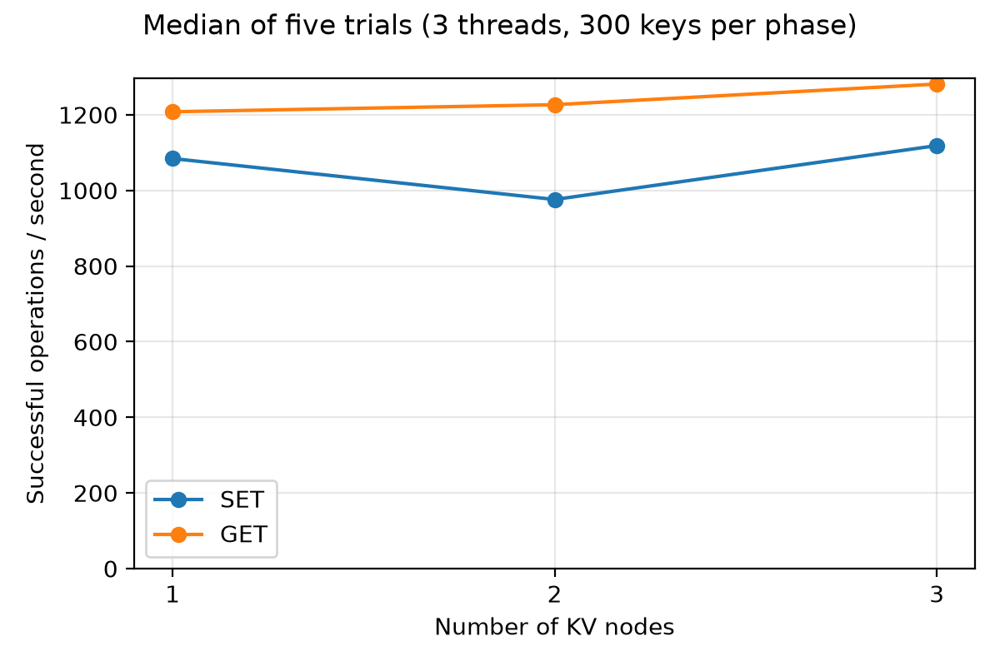
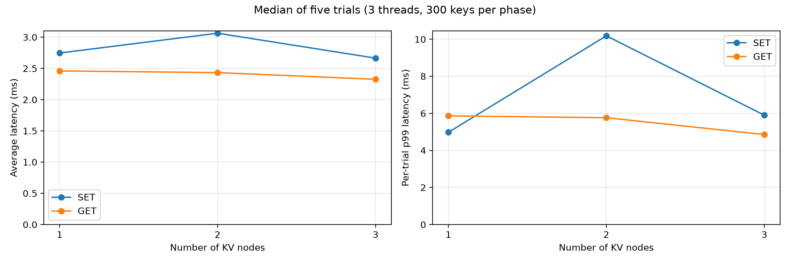

# Benchmark Comparison

Workload: 3 threads and 300 keys per phase.
One warm-up and five measured trials per configuration.

| Nodes | Phase | Throughput (ops/s) | Average (ms) | p99 (ms) |
| ---: | --- | ---: | ---: | ---: |
| 1 | SET | 1084.3 | 2.75 | 4.98 |
| 1 | GET | 1208.0 | 2.46 | 5.86 |
| 2 | SET | 976.0 | 3.06 | 10.18 |
| 2 | GET | 1226.7 | 2.43 | 5.76 |
| 3 | SET | 1118.5 | 2.66 | 5.90 |
| 3 | GET | 1281.3 | 2.33 | 4.86 |

Each metric is the median of five per-trial measurements.
The p99 column is the median of per-trial p99 latencies,
not a percentile calculated from pooled requests.

